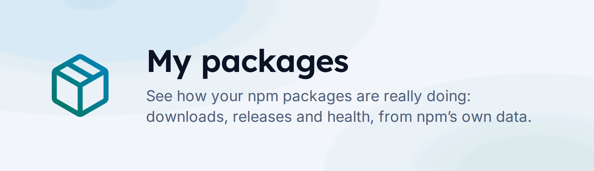

# mypackages.dev

<picture>
  <source media="(prefers-color-scheme: dark)" srcset="./public/logo/banner-dark.png">
  
</picture>

[](https://scorecard.dev/viewer/?uri=github.com/phun-ky/mypackages.dev)
[](https://www.bestpractices.dev/projects/16089)

[My packages](https://mypackages.dev) shows how npm packages, and the people who
maintain them, are doing: downloads month by month, releases, and a health score
for each package. Search any package or npm user; no account needed.

## What it shows

- **A package** (`/packages/<name>`, scoped names too): downloads for the last
  12 complete months, release history, dependencies, and a health score from
  maintenance, quality, security, popularity and provenance, with the reason for
  each.
- **A user** (`/users/<npm username>`): every package they maintain, with
  totals, what needs attention, what is doing well, and the packages by scope or
  in a table.
- **What people look up** (`/packages`, `/users`): the most looked up packages
  and users, and the latest lookups.
- **Signed in** (with GitHub): a dashboard of your own packages, and an npm
  token the site can use for you, so npm's rate limits hit less often.

## Where the numbers come from

| Data                                   | Source                                                                                     |
| -------------------------------------- | ------------------------------------------------------------------------------------------ |
| Package details, versions, maintainers | The npm registry, through the site's edge functions                                        |
| Which packages a user maintains        | npm's search, `maintainer:<username>`                                                      |
| Downloads                              | The [npm downloads API](https://github.com/npm/registry/blob/main/docs/download-counts.md) |
| Vulnerabilities                        | [OSV](https://osv.dev)                                                                     |
| Stars, forks and issues                | GitHub, GitLab, Bitbucket or Azure DevOps, for the package's repository                    |

The [FAQ](https://mypackages.dev/help/faq) explains how each number is counted.

### Limits

- **npm's data lags.** Download counts run to a day or two ago, so "last month"
  is the last complete calendar month, and the current month is never shown as
  complete.
- **Up to 500 packages per user.** npm's search gives 250 at a time; the site
  loads two pages and says so when a user has more.
- **Maintained, not authored.** A user's packages are the ones they maintain on
  npm. npm records the latest publisher as the author, which with trusted
  publishing is GitHub Actions.
- **Rate limits.** npm limits how much the site can fetch, more for signed-out
  visitors. Signing in and adding an npm token helps.
- **Cached in the browser.** Responses are kept in localStorage for up to a day;
  "Refresh data" on a user page fetches them again.

## Running it locally

You need Node.js 24 and npm.

```sh
npm ci
npm run dev
```

The site reads `VITE_SUPABASE_URL` and `VITE_SUPABASE_ANON_KEY` from
`.env.local` (not committed). Two things keep a local copy from using the
production project:

- the edge functions only answer `https://mypackages.dev`, and
- the Content Security Policy in `index.html` only allows the production
  Supabase host in `connect-src`.

To work against a local Supabase (`supabase start`), serve the functions with
`ALLOW_LOCAL_ORIGIN=true` in `supabase/functions/.env`
(`supabase functions serve`), point `.env.local` at the local project, and add
its URL to `connect-src` while you work. Don't commit that change.

The tests don't need Supabase: the end-to-end tests run against a build that
answers every request with mocks.

### Checks

| Command                  | What it checks                                                                |
| ------------------------ | ----------------------------------------------------------------------------- |
| `npm run lint`           | ESLint with no warnings allowed, and that styles only use colour tokens       |
| `npm run format:check`   | Prettier                                                                      |
| `npm run typecheck`      | TypeScript, for the source and the tests                                      |
| `npm run test:unit`      | Unit and property tests (`tests/unit`)                                        |
| `npm run test:coverage`  | The unit tests with coverage thresholds                                       |
| `npm run test:e2e`       | Builds with `.env.e2e`, then the Playwright tests in Chromium and Firefox     |
| `npm run build`          | The production build                                                          |
| `npm run check:metadata` | Titles, descriptions, link previews and the sitemap in `dist/`, after a build |

The edge functions are Deno, checked and tested with Deno 2:

```sh
deno check --no-lock supabase/functions/*/index.ts
deno lint --rules-exclude=no-import-prefix,no-explicit-any supabase/functions
DENO_NO_PACKAGE_JSON=1 deno test --no-lock --allow-env --allow-read=supabase/functions supabase/functions
```

`supabase test db` runs the database tests (`supabase/tests`) against a local
database with the migrations applied.

### Images

The link preview images and the icons are rendered from the marks in
`public/logo` by scripts, with the site's fonts and nothing from the network:
`npm run images:logo` and `npm run images:og`. Run them after changing a mark,
the design or the copy, and commit the files.

## How it deploys

There are no versions, tags or changelog: **every merge to `main` deploys.**

- **The site** is built by [`deploy.yml`](.github/workflows/deploy.yml) and
  published to GitHub Pages, with every static route written as its own page.
  Package and user pages are served from `404.html` (with status 404), which
  starts the app.
- **The edge functions** are deployed by
  [`supabase.yml`](.github/workflows/supabase.yml) when `supabase/functions`
  changes.
- **Database migrations** in `supabase/migrations` are applied by the maintainer
  with `supabase db push`, before or with the site change that needs them.

## Supabase setup

For a new Supabase project:

1. Link it and apply the migrations: `supabase link --project-ref <ref>`, then
   `supabase db push`. They create the tables, row level security, grants, and
   the daily job for the front page's example.
2. In Authentication, enable the GitHub provider, set the site URL to the site's
   origin, and allow the origin followed by `/` as a redirect URL.
3. For the daily example: store the project URL and a secret in Vault
   (`project_url`, `portfolio_snapshot_secret`), and the same secret as the
   function secret `PORTFOLIO_SNAPSHOT_SECRET`
   (`supabase secrets set PORTFOLIO_SNAPSHOT_SECRET=...`).
4. In the GitHub repository, set the secrets `VITE_SUPABASE_URL` and
   `VITE_SUPABASE_ANON_KEY` (the build) and `SUPABASE_ACCESS_TOKEN` (deploying
   the functions), and the project ref in `supabase.yml`.
5. Put the project's URL in `connect-src` in `index.html`. For a copy of the
   site on another domain, also change `SITE_ORIGIN` in
   `supabase/functions/_shared/http.ts`, the only origin the functions answer.

## More

- [Contributing](CONTRIBUTING.md): how to propose a change, and the checks it
  needs
- [Security policy](SECURITY.md): how to report a vulnerability
- [Privacy](PRIVACY.md): what the site stores, for how long, and how to delete
  it
- [Assurance case](ASSURANCE.md): the threat model, and how the site is
  protected and tested
- [Governance](GOVERNANCE.md) and [roadmap](ROADMAP.md)

## Licence

© Alexander Vassbotn Røyne-Helgesen

- **The code**, everything not listed below: [MIT](LICENSE).
- **The logo, icons and images**:
  [CC BY-NC-SA 4.0](https://creativecommons.org/licenses/by-nc-sa/4.0/). That is
  `public/logo.svg` and the files in `public/logo`, `public/meta` and
  `public/images`, and `public/nebula*`. You may share and adapt them, not
  commercially, with credit, and under the same licence.

The Creative Commons badge in `public/meta/cc-by-nc-sa-4.0-88x31.png` is
Creative Commons' own.
